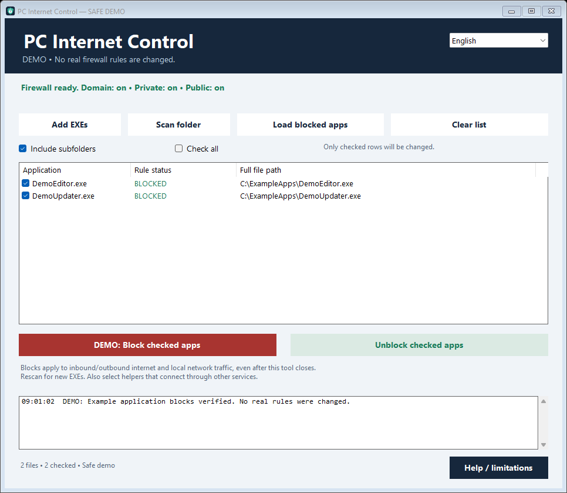

# PC Internet Control 🛡️

[](https://github.com/rotesham/pc-internet-control/actions/workflows/build.yml)
[](LICENSE)

A Windows Firewall manager for selected executable paths, with an **English / Turkish** interface. Select individual EXEs or scan the existing EXEs inside an application folder.

[Download the latest release](https://github.com/rotesham/pc-internet-control/releases/latest) · [Türkçe](README.tr.md) · [Security](SECURITY.md)



## Features

- Select multiple EXEs or scan a folder, optionally including subfolders.
- Add inbound and outbound block rules across Windows network profiles.
- Reload persistent managed rules and remove only this application's rules.
- Verify rules by reading them back; show partial/disabled configurations and recover from incomplete updates.
- Protect Windows system paths and the manager itself.
- Never disable firewall profiles, reset the firewall, or change global default traffic policies.

## Quick start

1. Download and extract the release ZIP, then open the executable.
2. Windows requests **administrator permission** to manage firewall rules. Approve only software you trust.
3. Choose **Add EXEs** or **Scan folder**. Selection and scanning alone do not change rules.
4. Tick the intended rows, click **Block selected**, and check the paths in the confirmation.
5. Restart the selected applications after applying their rules.

To restore access: **Load blocked apps → tick the rows → Unblock selected**.

**Clear list** only clears the on-screen list; it does not remove rules.

## Important limitations

> This is not a network-isolated virtual machine or an application sandbox. It cannot promise absolute isolation under all conditions.

- Blocking affects **internet and LAN** traffic. There is no internet-only / LAN-allowed mode.
- Rules match a **full executable path**. Folder mode scans existing files; it is not a live wildcard policy.
- Rescan after moving/copying executables or installing a new version in a different folder. Scans are capped at 500 EXEs, with skipped entries reported.
- Helper processes, shared services, browsers or other programs making connections on an application's behalf need separate evaluation. Windows loopback/local exceptions may apply.
- Administrator software and organization policies can alter or override local rules. The required firewall profiles must remain enabled.
- This version targets classic desktop EXEs, not DLLs, scripts or Store package identities.
- Blocking browsers, VPNs or remote-access programs can disconnect you. Check the selected paths.
- Removing this application does not remove its rules; unblock first or inspect the `PC Internet Kontrolu` group in Windows Firewall.
- Unsupported or externally scoped rule configurations must not be silently broadened or reported as unrestricted blocks.

## Build and test

Requires Windows and the .NET Framework C# compiler, with no NuGet dependencies. Locally tested on Windows 11.

```powershell
powershell -NoProfile -ExecutionPolicy Bypass -File .\build.ps1
```

Output: `build\PCInternetKontrolu.exe`. Default tests use a fake firewall and make no real rule changes.

```powershell
# Safe visual demonstration
.\build\PCInternetKontrolu.exe --demo

# Optional administrator integration test, only against FirewallProbe.exe.
powershell -NoProfile -ExecutionPolicy Bypass -File .\build.ps1 -RunIntegration
```

The opt-in live test verifies a fresh TCP connection, adds rules only for its dedicated probe, confirms a new connection is blocked, removes those rules and confirms connectivity returns. It cleans up its test rules and must not target real user applications. Network conditions can affect the test.

## Privacy

There is no telemetry or account login. Selected paths and operation results are written locally to `%LOCALAPPDATA%\PCInternetKontrolu\islem.log`; do not publish those logs. The optional integration test contacts a public endpoint. Screenshot paths are examples.

## License and trust

[MIT](LICENSE), copyright rotesham. Releases are **unsigned** and provided **as is**. Review and tests reduce risk but do not guarantee perfect security.
